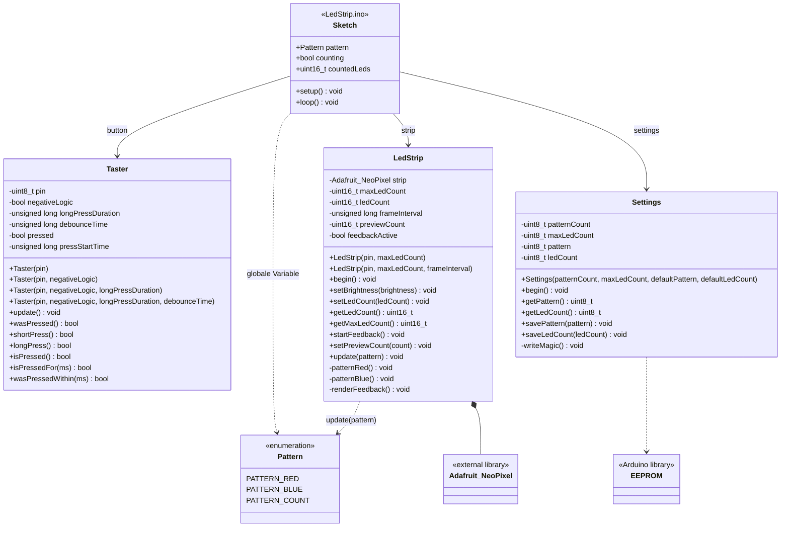
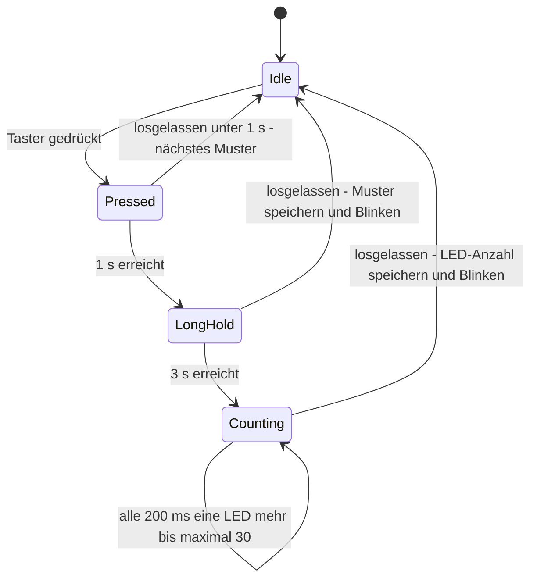
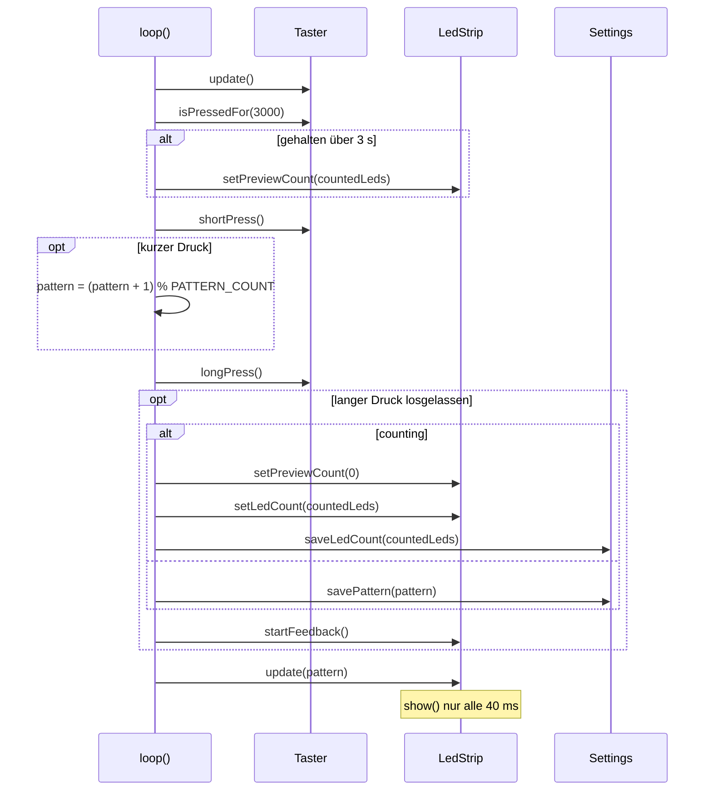
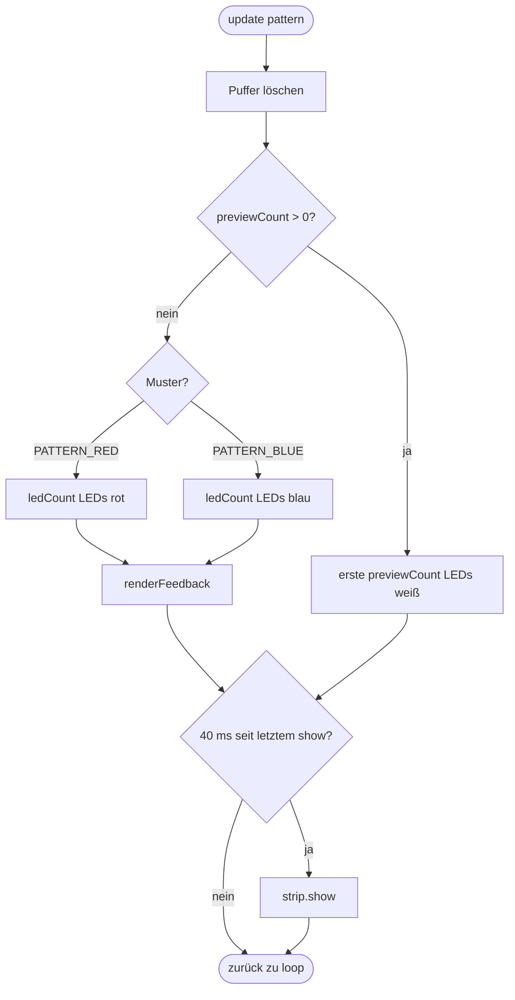

# UML-Darstellungen LedStrip-Projekt

Die Diagramme sind in Mermaid geschrieben und werden auf GitHub sowie in VS Code (mit Mermaid-Erweiterung) direkt dargestellt.

## 1. Klassendiagramm

Der Sketch verbindet die drei Klassen. Die Klassen kennen sich untereinander nicht; jede ist nur für ihre eigene Hardware zuständig (Taster-Pin, LED-Streifen, EEPROM).

## 2. Zustandsdiagramm der Tasterbedienung

Beschreibt, was je nach Haltedauer beim Loslassen passiert.

## 3. Sequenzdiagramm einer `loop()`-Runde

## 4. Aktivitätsdiagramm von `LedStrip::update()`

